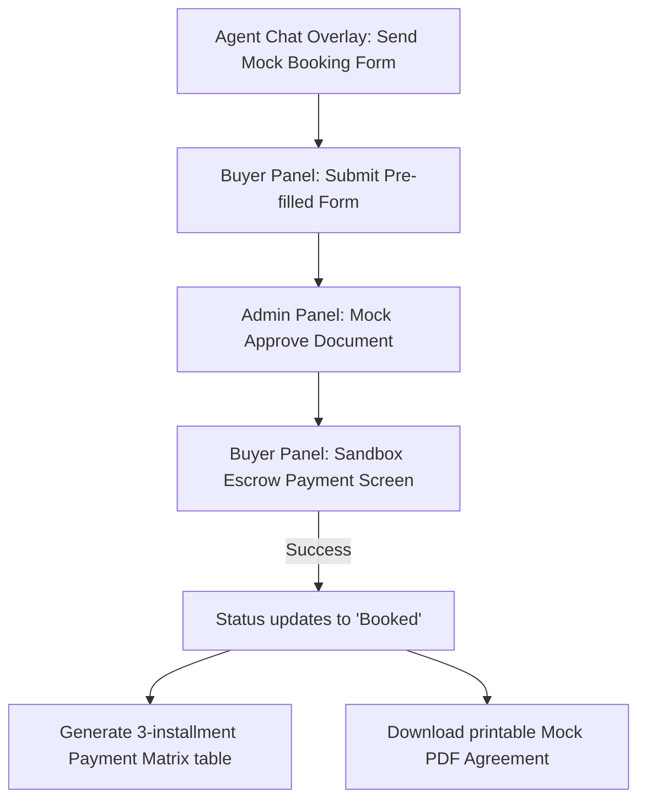

# Walkthrough - Mock Booking & Purchase Workflow

I have successfully designed and built the entire mock booking and purchasing workflow spanning the database schemas, backend routing handlers, and all three dashboard panels (Buyer, Agent, and Admin).

## Architecture & Data Flow

## Detailed Component Changes

### 1. Database & Endpoints
- **Model**: Introduced [mockBookingModel.js](file:///c:/Users/NEXACHAIN%20AI/Real%20Estate/Real-estateb/models/mockBookingModel.js) to store mock purchases. It includes installment schemas representing the 3-part split payment matrix.
- **Controller**: Created [mockBookingController.js](file:///c:/Users/NEXACHAIN%20AI/Real%20Estate/Real-estateb/controllers/mockBookingController.js) implementing:
  - `sendMockForm`: Sends form to client dashboard (`form_sent` status).
  - `submitMockForm`: Buyer uploads details document text (`form_submitted` status).
  - `approveMockDocument`: Admin triggers manual validation (`approved` status).
  - `payMockBooking`: Buyer clicks Sandbox payment success (`Booked` status, instantly generates a 3-part installment schedule split 10% / 40% / 50%).
  - `listMockBookings`: Serves query filters based on authenticated user roles.
- **Routes**: Mounted endpoints inside [bookingRoutes.js](file:///c:/Users/NEXACHAIN%20AI/Real%20Estate/Real-estateb/routes/bookingRoutes.js).

### 2. Agent Dashboard
- **Chat Actions**: Added a `"Send Mock Booking Form"` button directly inside client chat sessions. It prompts for property names and base listing price to dispatch forms.
- **Mock Ledger**: Integrated a **Mock Bookings** tab showing clients list, prices, active status badges, and the installment matrix once purchased.

### 3. Admin Dashboard
- **Approvals Panel**: Added a **Mock Bookings** tab under the roster category.
- **Document Approver**: Features a `"Mock Approve Document"` button next to submissions.

### 4. Buyer Dashboard
- **Form Submitter**: Tab displays dispatched forms with a `"Submit Pre-filled Form"` prompt.
- **Sandbox Payment Gateway**: Triggers an escrow gateway overlay when approved.
- **Mock PDF Agreement**: Generates printable client agreement contracts as text files.
- **Installment Calculator**: Displays the calculated 10% / 40% / 50% payment schedules.
